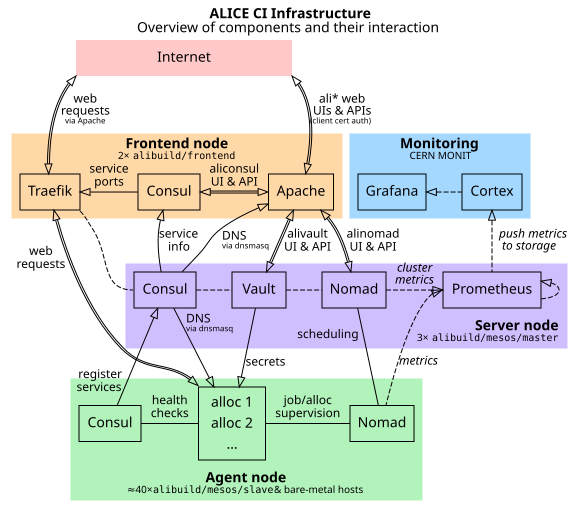

## Cluster architecture

<!-- Note: run `dot -Tsvg -oimages/nomad-infra.svg images/nomad-infra.dot` to regenerate this plot. -->
[](images/nomad-infra.svg)

[See here for an explanation of the underlying infrastructure.](infrastructure-machines.md)

## Nomad, Consul and Vault setup notes

### Automated provisioning with swarm-management-mcp

The manual procedure below is what a new node needs; on hand-managed machines it
is now driven by [`swarm-management-mcp`](https://gitlab.cern.ch/alisw/swarm-management-mcp),
which performs the same steps idempotently and refuses rather than half-configuring.
Its README carries the full runbook; the outline is:

1. **Describe the node.** Add it to `inventory.yaml` with `mgmt: manual`, and
   create `nodes/<fqdn>.conf` with the CPU and memory cap, the Nomad metadata,
   and the data directories. Anything machine-specific belongs there, so the
   decision is recorded in git rather than in someone's shell history.

2. **Install the dispatcher**, once, with `bootstrap-node.sh <fqdn>`. This is the
   only step that pushes anything to the machine. It installs a forced-command
   `authorized_keys` entry, so the key used afterwards can run a fixed set of
   verbs and cannot get a shell, and it verifies that restriction before
   reporting success.

3. **Provide the node's credentials.** A per-node Consul token and the cluster's
   existing gossip key are read from the operator's Keychain and streamed to the
   node, which validates them and writes `/etc/swarm/secrets.env`. They are never
   committed and never copied from a working tree.

4. **Deploy a signed revision.** The node clones a pinned, signed tag from GitLab
   itself, so what runs is always something published and blessed rather than
   whatever was on someone's laptop.

5. **Preview, then apply.** `dry-run` renders every file that would be written
   and diffs it against the machine, with secrets redacted but changes still
   visible, and lists the commands it would run — without executing any of them.
   `converge` then applies it.

6. **Verify it joined.** A client can start cleanly and still fail to register,
   so check with `nomad node status` rather than trusting a clean exit.

Two behaviours are worth knowing because they look like failures and are not.
Converge **refuses to reconfigure a `dnsmasq` it did not install**, since on a
shared machine that resolver may be serving other hosts; adopting it is an
explicit opt-in per node. And it **refuses to run without a grid host
certificate**, because Nomad's TLS, Consul and Vault settings all reference one
and a node without it joins and then fails everything placed on it.

### Nomad and Consul setup on non-Openstack machines

These are the underlying steps, for reference or for a machine the tooling does
not cover.

1. Add Hashicorp apt repo to get modern consul/nomad packages (the Ubuntu-packaged ones are too old to work with our config):
   ```bash
   curl -fsSL https://apt.releases.hashicorp.com/gpg | apt-key add -
   cat << EOF > /etc/apt/sources.list.d/hashicorp.list
   # Added <date> by <you>.
   # Required for newer versions of nomad and consul -- Ubuntu repo versions are too old.
   deb [arch=amd64] https://apt.releases.hashicorp.com $(lsb_release -cs) main
   EOF
   apt update
   apt install nomad consul
   systemctl stop nomad consul   # for now
   mkdir /build/consul /build/nomad
   chown consul:consul /build/consul
   ```

   Ignore any errors about packages not being able to create directories in `/opt`. Jalien stuff is mounted there, and consul/nomad would only create their default data directory there (which we don't use).
2. Use [`consul.hcl`](https://gitlab.cern.ch/ai/it-puppet-hostgroup-alibuild/-/blob/master/code/templates/etc/consul.d/consul.hcl.erb) and [`nomad.hcl`](https://gitlab.cern.ch/ai/it-puppet-hostgroup-alibuild/-/blob/master/code/templates/etc/nomad.d/nomad.hcl.erb) from Puppet (use the links or get them from `/etc/nomad.d` / `/etc/consul.d` on a Puppet-managed host), but adapt by setting the correct IP address for `advertise_addr` and/or `bind_addr`, and substituting Teigi secrets manually.

   Also, change the location of Grid certificates if necessary, both for nomad's multiple `tls` settings and for nomad's `host_volumes`. Nomad itself runs as root, so no filesystem ACL adjustments should be necessary (but as before, the CI should be allowed access to them via the `mesos{ci,daq}` users).

   For `alissandra` machines, [reserve](https://www.nomadproject.io/docs/configuration/client#reserved-parameters) half the resources so the CI system doesn't take up too much of the host.
3. Add a `server=/consul/137.138.62.94` line to `/etc/dnsmasq.conf` and restart `dnsmasq.service`. This is required for Nomad to look up Vault hosts at `vault.service.consul`.
4. Start the daemons:
   ```bash
   systemctl enable --now nomad consul
   journalctl -fu nomad   # to watch logs
   ```

   An autogenerated nomad-client entry for the host should now appear in consul, and the new nomad client should appear in the nomad web UI.

### Vault settings applied to our cluster

#### Allow Nomad clients access to secrets

Secret substitution happens on the nomad client that receives a job. It has a `nomad-server` token, with which it has to get a temporary `nomad` token (which it in turn uses to fetch secrets).

```bash
vault write auth/token/roles/nomad-server allowed_policies='default, nomad, nomad-server' orphan=true
vault write auth/token/roles/nomad allowed_policies='default, nomad' orphan=true token_period=1d
```

#### Allow issuing essentially non-expiring tokens

By default, tokens expire after a month, which means the nomad cluster breaks and tokens have to be manually updated.

Change the default max expiry time to 100 years instead.

```bash
vault write sys/auth/token/tune default_lease_ttl=3155760000s max_lease_ttl=3155760000s
```

Tokens can still be revoked manually using any one of the following commands:

```bash
vault token revoke '<secret token here>'
# Or alternatively:
vault token revoke -accessor '<token accessor here>'
```

This will revoke any child tokens of the given token as well, unless the `-mode=orphan` option is given.

## Troubleshooting

### Leftover Consul services aren't deregistered

Sometimes, Consul can get into a state where services were registered but never deregistered.
In particular, this happens when a host changes its public IP address -- in that case, the old service remains registered because a Consul agent with the same *host name* is still available, even though the service's public IP address is wrong.

If this happens, deregister the service with the wrong IP manually by running the following:
```bash
ssh host-with-changed-ip.cern.ch "CONSUL_HTTP_TOKEN=$(pass .../consul-token)" consul services deregister -id offending-service-id
```
...where the `pass` command prints out your Consul token, `host-with-changed-ip` is the affected hostname, and `offending-service-id` is the ID of the old service with the wrong IP, e.g. `_nomad-client-xd2yun6h34z5nni56pdncbqb6b3mjfcf`.

It is critical that the `consul services deregister` command runs on the host that originally registered the service.
If you run the plain `consul` command locally, e.g. against one of the Consul master nodes, it will fail with a "service not found" error, even if the ID is correct.
